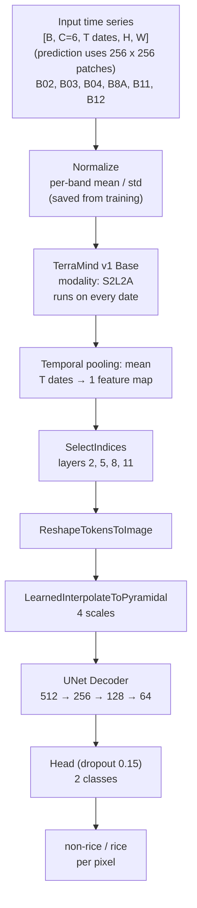

# Rice Field Mapping with TerraMind (Multi-temporal Sentinel-2)

Find **rice fields** from a **time series of Sentinel-2 images** using the **TerraMind** geospatial foundation model.
The model looks at several dates of the same place, because rice changes a lot during the season
(water → green → yellow → harvested). That change is the key signal for finding rice.

> This repo is a **step-by-step guide** for anyone who wants to start a geospatial foundation model project.
> I tried to explain *why* each step exists, not just *what* the code does.

---

## What you get

| Notebook | What it does |
|---|---|
| [`01_finetune_rice_multitemporal.ipynb`](notebooks/01_finetune_rice_multitemporal.ipynb) | Fine-tune TerraMind on your rice dataset (HDF5 shards) |
| [`02_predict_rice_full_image.ipynb`](notebooks/02_predict_rice_full_image.ipynb) | Predict rice on a full Sentinel-2 tile (10980 × 10980 px) |

**Fine-tune notebook features**

- 3 modes: `pretrained` (start from Hugging Face), `resume` (continue from a checkpoint), `auto`
- Checks that the dataset matches the checkpoint (bands, dates, classes) **before** training
- Smoke test on one batch before the long training run
- Automatic **threshold calibration** on the validation set
- Saves `best.ckpt`, `last.ckpt`, `training_config.json` and `normalization_stats.json`

**Prediction notebook features**

- Full-tile inference with 50% overlap and smooth blending
- **Resume** if Colab disconnects in the middle
- Auto batch-split on *CUDA out of memory*
- Output: rice probability GeoTIFF, rice mask GeoTIFF, and optional polygons with area in m² and **rai**

> **Not included:** the training dataset, the labels, and the trained checkpoint.
> You need to prepare your own data (see [Data format](#-data-format)).

---

## Model architecture



| Part | Setting |
|---|---|
| Backbone | `terramind_v1_base`, modality `S2L2A` |
| Bands | Blue, Green, Red, Narrow NIR, SWIR 1, SWIR 2 |
| Time | `backbone_use_temporal=True`, `temporal_pooling="mean"` |
| Decoder | `UNetDecoder [512, 256, 128, 64]` |
| Loss | `0.6 × CrossEntropy + 0.4 × Dice` with class weights |
| Learning rate | decoder `1e-4`, backbone `1e-5` (smaller, so TerraMind does not "forget") |
| Optimizer | AdamW + CosineAnnealing |
| Ignore label | `255` (uncertain pixels) |

---

## Full workflow

```mermaid
flowchart LR
    subgraph Prep [Your data preparation]
        A[Sentinel-2 L2A<br/>several dates] --> B[Stack bands<br/>10 m grid]
        B --> C[Labels<br/>0 non-rice · 1 rice · 255 ignore]
        C --> D[(HDF5 shards<br/>train / val / test)]
    end
    subgraph Train [01 · Fine-tune]
        D --> E[Copy to Colab SSD]
        E --> F[Check dataset ↔ checkpoint]
        F --> G[Normalization +<br/>class weights]
        G --> H[Smoke test]
        H --> I[Train with Lightning]
        I --> J[Threshold calibration]
        J --> K[(best.ckpt +<br/>training_config.json)]
    end
    subgraph Pred [02 · Predict]
        K --> L[Full tile<br/>patch 256 · stride 128]
        L --> M[Weighted blend]
        M --> N[Rice probability + mask]
        N --> O[Optional polygons<br/>area m² / rai]
    end
```



---

## Quick start (Google Colab)

1. Open the notebook in **Google Colab** and select a **GPU** runtime (T4 works; L4 or A100 is faster).
2. Run the **install cell**, then **restart the session** if Colab asks.
3. Edit **only** the *USER CONFIGURATION* cell:

```python
PROJECT_ROOT = Path("/content/drive/MyDrive/Rice_Detect_TerraMind")
DATASET_DIR  = PROJECT_ROOT / "AOI_output" / "processed_2026" / "rice_train_ready_multitemporal_final"
MODEL_DIR    = PROJECT_ROOT / "Rice_TerraMind_Training" / "terramind_rice_multitemporal_final"

TRAINING_MODE = "pretrained"   # first time: start from Hugging Face TerraMind
```

4. Run all cells from top to bottom.
5. (Optional) Add `HF_TOKEN` in **Colab → Secrets** for faster Hugging Face downloads. It is not required.

>  The notebook text is written in **Thai**, but the code is in English.

---

## Data format

### Training data: HDF5 shards

```text
dataset/
└── shards/
    ├── train_shard_000.h5
    ├── val_shard_000.h5
    └── test_shard_000.h5
```

Each sample inside the `.h5` file:

| Key | Shape | Required |
|---|---|---|
| `images` | `[T, C, H, W]` | Yes |
| `valid_masks` | `[T, H, W]` | Yes |
| `timestep_quality` | `[T]` | Yes |
| `labels` | `[H, W]`: `0` non-rice, `1` rice, `255` ignore | Yes |
| `imputed_masks` | `[T, H, W]` | optional |
| `timestamps` | `[T]` | optional |
| `band_names` | `[C]` | optional |

### Prediction data: GeoTIFF stacks

```text
processed_2026/
├── stacks_10m/
│   ├── ..._20260313_..._STACK_....tif
│   └── ..._20260326_..._STACK_....tif
└── valid_masks_10m/
    ├── ..._20260313_..._VALID_MASK_....tif
    └── ...
```

- The date is read from the filename (an 8-digit `YYYYMMDD` date, e.g. `20260313`).
- With `TIMESTAMP_POLICY = "training_exact"`, the dates must match the training dates.
- If the bands have no names, the default band positions are `B02=1, B03=2, B04=3, B8A=8, B11=9, B12=10`.

---

## Use this for your own project

- **Another crop** (sugarcane, cassava, …)? Change the labels and `class_names`. Everything else stays the same.
- **More classes?** Set `num_classes` and the class weights to match.
- **Different dates?** Use `TRAINING_MODE = "pretrained"` (do **not** resume from a checkpoint made with different dates).
- **Different area?** Calculate new normalization stats. Do not reuse old ones.

---

## Common problems

| Problem | Fix |
|---|---|
| `ResolutionImpossible` during install | Do not pin `numpy==1.26.4` with TerraTorch 1.2.10 |
| `terratorch has no attribute __version__` | Use `importlib.metadata.version("terratorch")` |
| PyTorch shows `+cpu` | Select a GPU runtime and restart |
| Hugging Face HTTP 504 | Retry and cache are built in. Add `HF_TOKEN` |
| Dataset does not match checkpoint | Use `TRAINING_MODE = "pretrained"` |
| Colab disconnects | Run again with the same `RUN_NAME`. It resumes automatically |
| Output only 2048 × 2048 | The notebook always predicts the full tile. Check your input stack |
| High metric but the map looks wrong | Your labels may be pseudo-labels. Check visually / with real ground truth |

---

## Learn more

- [Beginner's guide to GeoFM and TerraMind](docs/GEOFM_BEGINNER_GUIDE.md)
- TerraMind model: https://huggingface.co/ibm-esa-geospatial/TerraMind-1.0-base
- TerraMind paper: https://arxiv.org/abs/2504.11171
- TerraTorch: https://github.com/torchgeo/terratorch
- Lightning checkpointing: https://lightning.ai/docs/pytorch/stable/common/checkpointing_basic.html

## Related repos

Part of my geospatial foundation model series:
- [Building footprint (THEOS-2)](https://github.com/mastersungx1/terramind-building-footprint-theos2)
- [Rice mapping (Sentinel-2 time series)](https://github.com/mastersungx1/terramind-rice-mapping-sentinel2)
- [Flood mapping (Sentinel-1 + 2)](https://github.com/mastersungx1/terramind-flood-mapping-sen1floods11)
- [Road extraction (THEOS-2)](https://github.com/mastersungx1/theos2-road-extraction-multitask)

## Acknowledgement

Developed during my internship at **I-bitz (Insight)**. Thank you to the team for the support and for allowing me to share this work.
The company's data, labels and trained checkpoints are **not** part of this repository.

## License

Code: [MIT](LICENSE). TerraMind and TerraTorch have their own licenses.
